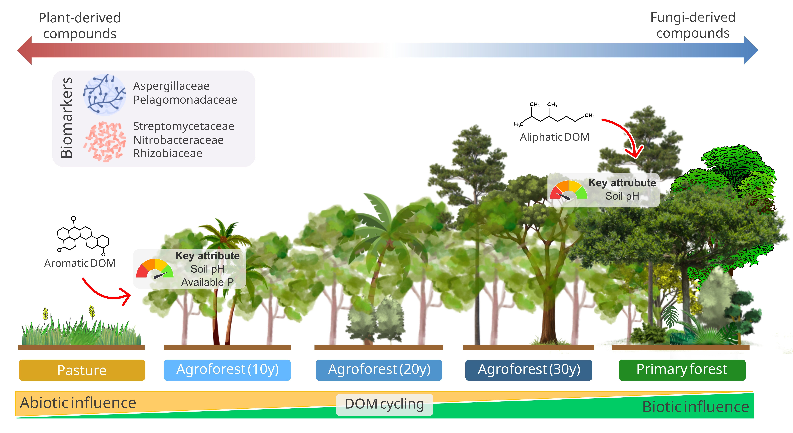
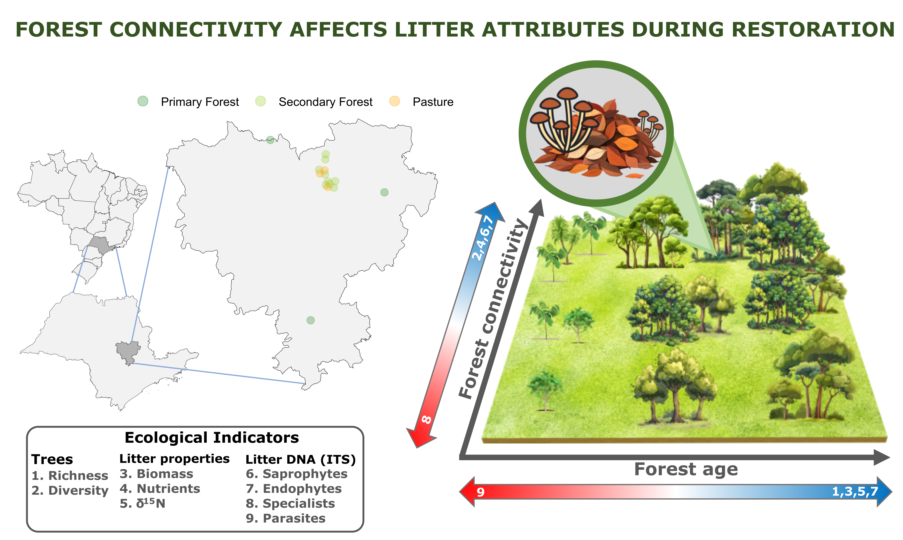

## Agroforestry succession is linked to soil carbon stabilization in tropical ecosystems

Tropical agroforestry systems are essential to balancing food production, smallholder income, and sustainable natural resource use. In this study, we explored biogeochemical and microbial interactions in tropical environments that are still not fully understood.

We investigated the associations between dissolved organic matter (DOM) composition and microbial functional genes involved in soil carbon cycling across Amazonian agroforestry systems at different successional stages. Our findings show that soil microorganisms shape their metabolic potential according to the resources available in the DOM.

Degraded pasture and early agroforest systems (~10 years) contain a less diverse pool of DOM compounds with lower structural complexity, favoring faster organic matter cycling but potentially contributing less to soil carbon stabilization. In contrast, older agroforestry systems (~30 years) present more complex vegetation structure, resulting in a higher diversity of DOM compounds with greater structural complexity. These conditions promoted slower and potentially more stable organic matter cycling, driven primarily by soil fungal communities.

Our results highlight the importance of sustainable agriculture in reconciling agricultural production with the preservation of stable carbon pools in Amazonian soils.

Full open access [here](https://doi.org/10.1016/j.jenvman.2026.131266).

## How does forest cover affect the litter fungal community on secondary forests?

Forest fragmentation is a problem that limits forest restoration projects, hindering the recovery of ecosystem services in secondary forests and creating the risk that a forest fragment may never become self-sufficient. Many of these problems arise from increased edge effects, lower plant and animal biodiversity, and consequently reduced biological activity within these fragments.

Soil microorganisms are frequently used as bioindicators of biological processes and can respond long before the effects become visible in other organisms, such as fully developed trees. For this reason, we set out a field study to understand how the fungi community varied across different levels of forest fragmentation (in this case, using percentage of forest cover) in secondary forests of different ages. The aim of the study was to understand whether functional groups of fungi would shift according to these variables, and whether an increase in vegetation cover in secondary forests would help restore some of their ecosystem functions, such as organic matter cycling. For this reason, we chose to focus on litter fungi, as they are the first agents to act in the decomposition of organic matter and its ecology remain a poorly understood in tropical environments.

From this study, we observed that increased forest cover during forest restoration helped to increase tree diversity over time and, in turn, this improved the nutritional quality of the litter, which altered the abundance of different functional groups such as wood decomposers, endophytic fungi, plant parasites, and pathogenic fungi. Greater forest cover increased the presence of beneficial groups while reducing the presence of pathogenic organisms, indicating that forest restoration is about far more than time alone — it is about restoring forests with greater potential to self recovery and connecting isolated forest fragments.

Read the full story of this study [here](https://doi.org/10.1111/mec.70325).

